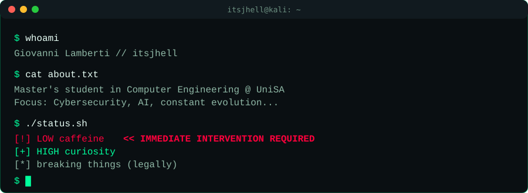

<!--
  ██╗ ████████╗ ███████╗      ██╗ ██╗  ██╗ ███████╗ ██╗      ██╗
  ██║ ╚══██╔══╝ ██╔════╝      ██║ ██║  ██║ ██╔════╝ ██║      ██║
  ██║    ██║    ███████╗      ██║ ███████║ ███████╗ ██║      ██║
  ██║    ██║    ╚════██║ ██   ██║ ██╔══██║ ██╔════╝ ██║      ██║
  ██║    ██║    ███████║ ╚█████╔╝ ██║  ██║ ███████║ ███████╗ ███████╗
  ╚═╝    ╚═╝    ╚══════╝  ╚════╝  ╚═╝  ╚═╝ ╚══════╝ ╚══════╝ ╚══════╝
-->

<div align="center">


<a href="https://git.io/typing-svg">
  
</a>


</div>

---



---

## `> ./skills --list`


<div align="center">

**// LANGUAGES**


**// SYSTEMS**


**// TOOLS**


</div>

---

## `> ls ./projects`

<table>
<tr>
<td width="50%">

**🛡️ Security Algorithms & Protocols**
`Python` · Gruppo 14
Algoritmi e protocolli di sicurezza.
[`> open repo`](https://github.com/VxVilla55/Project-Security_Algorithms-Protocols---Gruppo-14)

</td>
<td width="50%">

**🧠 Machine Learning**
`Jupyter Notebook` · Gruppo 12
Classificazione di immagini di rifiuti (PyTorch).
[`> open repo`](https://github.com/VxVilla55/Project-Machine-Learning---Gruppo-12)

</td>
</tr>
<tr>
<td width="50%">

**🏗️ Software Architecture Design**
`Java` · Gruppo 10
Progetto di architettura software.
[`> open repo`](https://github.com/VxVilla55/Project-Software-Architecture-Design---Gruppo-10)

</td>
<td width="50%">

**📇 MyContactManager**
`HTML`
Rubrica per nominativi, numeri e e-mail.
[`> open repo`](https://github.com/VxVilla55/MyContactManager)

</td>
</tr>
</table>

---


## `> cat stats.log`
 
### GITHUB STATISTICS
 
<div align="center">

</div>

### CONTRIBUTION MATRIX
 
<div align="center">

</div>

---


<div align="center">

[](https://github.com/itsjhell)

```text
 "The only truly secure system is one that is powered off,
  cast in a block of concrete and sealed in a lead-lined room."
                                              — Gene Spafford
```
```
"Reality is just another system waiting to be explored."
```


</div>


---

<br><br><br><br><br><br><br><br><br><br><br>
<br><br><br><br><br><br><br><br><br><br><br>
<br><br><br><br><br><br><br><br><br><br><br>

# OLD

<div align="center">


</div>

---

```bash
┌──(itsjhell㉿matrix)-[~]
└─$ whoami

[+] Identity: Giovanni Lamberti
[+] Role: Computer Engineering Student
[+] Focus: Cybersecurity / AI
[+] Environment: Linux / Windows
[+] Status: Constantly evolving...

┌──(itsjhell㉿matrix)-[~]
└─$ cat /etc/motd

"Reality is just another system waiting to be explored."
```

## `03` // ACCESSING MY PROJECTS

```bash
┌──(itsjhell㉿matrix)-[~/repositories]
└─$ ls -la

drwxr-xr-x  MyContactManager/
drwxr-xr-x  vinyl_collection_app/
drwxr-xr-x  Project-Machine-Learning/
drwxr-xr-x  Project-Security-Algorithms-Protocols/
drwxr-xr-x  Project-Software-Architecture-Design/
```

| Repository | Description |
|:---|:---|
| [MyContactManager](https://github.com/itsjhell/MyContactManager) | Contact management application |
| [Vinyl Collection](https://github.com/VxVilla55/vinyl_collection_app) | Vinyl collection manager |
| [Machine Learning](https://github.com/VxVilla55/Project-Machine-Learning---Gruppo-12) | Machine learning experiments |
| Security Algorithms | Security algorithms and protocols |
| Software Architecture | Software architecture and design |

<div align="center">


**`CONNECTION TERMINATED // END OF TRANSMISSION`**

</div>

<!--
**itsjhell/itsjhell** is a ✨ _special_ ✨ repository because its `README.md` (this file) appears on your GitHub profile.

Here are some ideas to get you started:

- 🔭 I’m currently working on ...
- 🌱 I’m currently learning ...
- 👯 I’m looking to collaborate on ...
- 🤔 I’m looking for help with ...
- 💬 Ask me about ...
- 📫 How to reach me: ...
- 😄 Pronouns: ...
- ⚡ Fun fact: ...
-->
