<!--
  ██╗ ████████╗ ███████╗      ██╗ ██╗  ██╗ ███████╗ ██╗      ██╗
  ██║ ╚══██╔══╝ ██╔════╝      ██║ ██║  ██║ ██╔════╝ ██║      ██║
  ██║    ██║    ███████╗      ██║ ███████║ █████╗   ██║      ██║
  ██║    ██║    ╚════██║ ██   ██║ ██╔══██║ ██╔══╝   ██║      ██║
  ██║    ██║    ███████║ ╚█████╔╝ ██║  ██║ ███████╗ ███████╗ ███████╗
  ╚═╝    ╚═╝    ╚══════╝  ╚════╝  ╚═╝  ╚═╝ ╚══════╝ ╚══════╝ ╚══════╝

  [!] you opened the source. curiosity detected.
  [+] flag{y0u_r34d_th3_r34dm3_s0urc3}
-->

<div align="center">



<a href="https://git.io/typing-svg">
  
</a>

<br/>


</div>


## `┌──(itsjhell㉿kali)-[~/arsenal]` <br/> `└─$ ./skills --list`

<div align="center">

<!--
<sub><code>// LANGUAGES</code></sub>
<br/>


<sub><code>// AI · ML</code></sub>
<br/>


<sub><code>// OFFENSIVE · DEFENSIVE</code></sub>
<br/>


<sub><code>// SYSTEMS · TOOLS</code></sub>
<br/>


-->


<code>// LANGUAGES</code><br>


<code>// SYSTEMS</code> <br>


<code>// TOOLS</code> <br>


</div>


## `┌──(itsjhell㉿kali)-[~/repositories]` <br/> `└─$ ls -la --classified`

<table>
<tr>
<td width="50%" valign="top">

### 🧠 `waste-classifier.cnn`
<sub>`[ML]` · Python · PyTorch</sub>

Convolutional neural network that classifies waste types from images.

<a href="https://github.com/VxVilla55/Project-Machine-Learning---Gruppo-12"></a>

</td>
<td width="50%" valign="top">

### 🛡️ `security-algorithms.proto`
<sub>`[CRYPTO]` · Python</sub>

Design and implementation of cryptographic algorithms and security protocols.

<a href="https://github.com/VxVilla55/Project-Security_Algorithms-Protocols---Gruppo-14"></a>

</td>
</tr>
<tr>
<td width="50%" valign="top">

### 🔄 `playlist-manager.agile`
<sub>`[ARCH]` · Java · SCRUM</sub>

Music playlist manager designed and built with an Agile / SCRUM workflow.

<a href="https://github.com/VxVilla55/Project-Software-Architecture-Design---Gruppo-10"></a>

</td>
<td width="50%" valign="top">

### ⌨️ `makroo.exe`
<sub>`[TOOL]` · Python</sub>

Records and replays automated macros and clicks.

<a href="https://github.com/itsjhell/Makroo"></a>

</td>
</tr>
<tr>
<td width="50%" valign="top">

### 💽 `vinyl-collection.apk`
<sub>`[MOBILE]` · Dart · Flutter</sub>

App to catalog and manage a vinyl record collection.

<a href="https://github.com/VxVilla55/vinyl_collection_app"></a>

</td>
<td width="50%" valign="top">

### 📇 `my-contact-manager.jar`
<sub>`[DESKTOP]` · Java</sub>

Address book for contacts, phone numbers and emails.

<a href="https://github.com/VxVilla55/MyContactManager"></a>

</td>
</tr>
</table>


## `┌──(itsjhell㉿kali)-[/var/log]` <br/> `└─$ tail -f activity.log`

<div align="center">


<!--

-->
<br/><br/>

<code>// CONTRIBUTION MATRIX - snake.exe</code>


</div>


<div align="center">

<a href="https://github.com/itsjhell"></a>

```text
 follow the white rabbit.
```

<sub><code>CONNECTION TERMINATED // END OF TRANSMISSION</code></sub>


</div>
